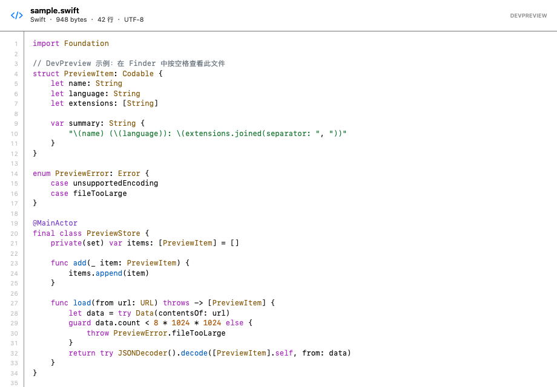
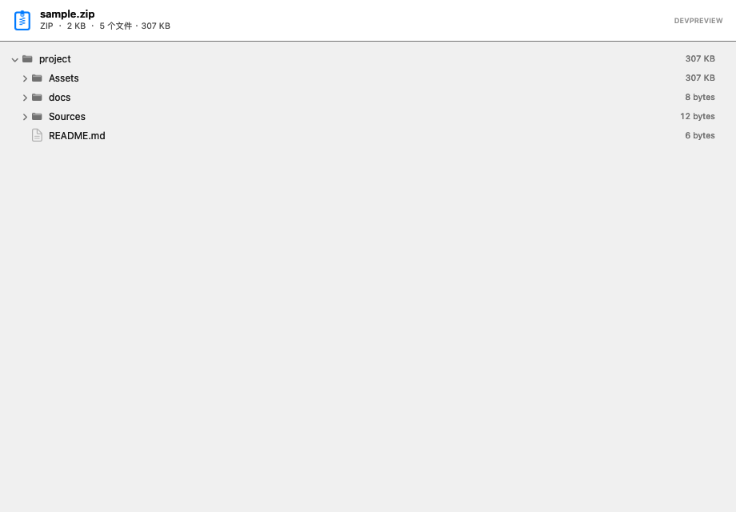
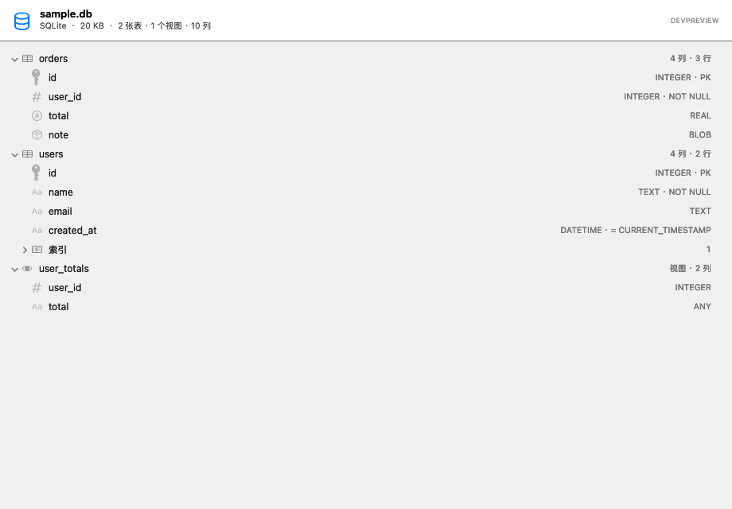

# DevPreview

在 Finder 里按空格，直接看代码、压缩包结构和 SQLite 表结构。



DevPreview 是一个 macOS Quick Look 扩展。它把系统默认的纯文本预览换成带语法高亮、行号和自动换行的代码阅读器，并额外支持压缩包目录和 SQLite schema 预览。所有解析都在本机完成，不联网、不上传文件内容。

## 为什么做这个

开发时经常要在 Finder 里翻文件：看一段配置、确认 jar 包里有没有某个类、查一个 SQLite 表结构。macOS 自带的 Quick Look 对代码只显示纯文本，对压缩包只显示图标，对数据库没有预览。为这点事打开 IDE 或解压工具，成本远高于收益。

DevPreview 只做一件事：**在 Finder 里按空格，看到足够做判断的信息**。所以它只读、不解压落盘、不联网。

## 功能

- 语法高亮：Swift、Objective-C、C/C++、Go、Rust、Python、JavaScript/TypeScript、Java/Kotlin、C#、Ruby、PHP、Shell、SQL、HTML/XML、CSS、JSON、YAML、TOML、Markdown、Diff、Dockerfile、Terraform、GraphQL、Protocol Buffers、CMake、Nix、Lua、Zig、Solidity 等
- 行号、等宽字体、自动换行，长行和日志不需要横向拖动
- 编码识别：UTF-8、UTF-16 LE/BE、UTF-32、GB18030、Latin-1
- 大文件分块读取：64 KB 一块，最多预览前 512 KB；超过 256 KB 关闭高亮，保证打开速度
- 压缩包结构浏览：不解压整个文件，直接读中央目录或 TAR 头，显示目录树和聚合大小
- SQLite 结构浏览：表/视图、列类型与约束、主键/非空/默认值、行数、索引
- 二进制 plist 自动转换为 XML 显示
- 隐私：所有解析和渲染都在本地完成

## 截图

### 代码预览

语法高亮、行号、自动换行，顶部显示语言、文件大小、行数和编码。


### 压缩包结构

直接看 zip / jar / apk / ipa / tgz 里的目录结构，按目录聚合大小，不用先解压。



### SQLite 结构

表、视图、列类型、主键、非空、默认值、行数和索引，一屏看完。



## 支持格式

| 类别 | 格式 |
| --- | --- |
| 编程语言 | Swift、Objective-C、C/C++、Go、Rust、Python、JavaScript、TypeScript、Vue、Svelte、Java、Kotlin、C#、Dart、Ruby、PHP、Shell、SQL、Lua、Zig、Scala、Groovy、Elixir、Erlang、Haskell、Clojure、Solidity、PowerShell、Batch、Assembly、R、Julia、Vim、Metal、LaTeX、Starlark/Bazel |
| 配置与数据 | JSON/JSONL/NDJSON/HAR、YAML、TOML、XML/Plist、INI/Properties、Dockerfile、Makefile、Terraform/HCL、GraphQL、Protocol Buffers、Jsonnet、Prisma、CMake、Nix |
| Apple 工程 | `.xib`、`.storyboard`、`.strings`、`.stringsdict`、`.xcprivacy`、`.mobileconfig`、`.entitlements`、`.pbxproj`、`.xcscheme`、`.xcconfig`、`.podspec`、`.modulemap` |
| .NET 工程 | `.csproj`、`.fsproj`、`.vbproj`、`.props`、`.targets`、`.sln`、`.resx`、`.xaml`、`.cshtml`、`.razor` |
| 压缩包 | `.zip`、`.jar`、`.war`、`.ear`、`.aar`、`.apk`、`.aab`、`.ipa`、`.xpi`、`.vsix`、`.nupkg`、`.whl`、`.epub`、`.kmz`、`.sketch`、`.tar`、`.tar.gz`、`.tgz`、`.gz` |
| 数据库 | `.sqlite`、`.sqlite3`、`.db`、`.sqlitedb` |
| 文档与日志 | Markdown、reStructuredText、AsciiDoc、纯文本/日志、CSV/TSV、Diff/Patch、Jupyter Notebook、LaTeX、Org、Textile、PO |

图片、音视频、PDF、Office、DMG 等 macOS 已自带预览的格式不重复实现。

## 安装

### 下载安装包

从 [Releases](https://github.com/onlyless/devpreview/releases/latest) 下载 `DevPreview-1.0.1-macOS.zip`，解压后把 `DevPreview.app` 拖进 `/Applications`。

安装包使用 ad-hoc 签名，首次打开会被 Gatekeeper 拦截。任选一种方式：

- 在 Finder 里右键 App → 打开 → 再点「打开」
- 或执行：

```bash
xattr -dr com.apple.quarantine /Applications/DevPreview.app
```

打开 App，点「启用扩展」。如果系统没有自动启用，进入「系统设置 → 通用 → 登录项与扩展 → 快速查看」，打开 DevPreview。

安装包同时包含 Apple Silicon 和 Intel 版本。

### 从源码构建

要求 macOS 13 Ventura 或更高版本、Xcode 15 或更高版本。

```bash
git clone https://github.com/onlyless/devpreview.git
cd devpreview
./scripts/install.sh
```

没有开发者团队时，脚本使用 ad-hoc 签名，并把 App 安装到 `/Applications`（没有写权限时退回 `~/Applications`）。

有开发者团队时：

```bash
DEVELOPMENT_TEAM=你的TeamID ./scripts/install.sh
```

也可以用 Xcode：

```bash
open DevPreview.xcodeproj
```

给 `DevPreview` 和 `DevPreviewExtension` 两个 Target 选择 Signing Team，然后 Run。

## 使用

1. 在 Finder 选中任意支持的文件
2. 按空格
3. 用方向键或滚轮阅读；长行会自动换行

App 首页可以查看完整格式列表、检查扩展状态、重载 Quick Look 缓存，也可以点「测试预览」生成一个示例并调用 `qlmanage -p`。

终端测试：

```bash
qlmanage -p Examples/sample.swift
qlmanage -p Examples/sample.md
qlmanage -p path/to/archive.zip
qlmanage -p path/to/database.db
```

查看扩展是否注册：

```bash
pluginkit -m -i com.zhangzheng.DevPreview.Extension
```

输出以 `+` 开头表示已启用，`-` 开头表示已注册但未启用。

## 性能与边界

预览的目标是「快速判断」，不是完整读取，因此每个格式都有明确上限：

- 文本最多读 512 KB，按 64 KB 分块读，不会一次性把大文件读进内存
- 超过 256 KB 关闭语法高亮，只保留行号和自动换行
- ZIP 最多列出 20,000 个条目；只读目录区，不触碰文件内容
- TAR.GZ 最多解压 32 MB，超出会提示只列出部分内容
- SQLite 只读打开（`mode=ro&immutable=1`），不会修改数据库；最多列 500 个对象，行数统计有 2 秒总预算，超时显示「行数未知」
- 加密 ZIP 仍可看到文件名，因为只读取未加密的目录区

不内置 7z、RAR、XZ、BZ2 解码器。引入这些格式意味着引入第三方解码库和安全攻击面，而系统或专用工具已经能处理；DevPreview 选择不做。

压缩包只浏览结构，不展开包内文件；需要看内容时仍请解压或用对应工具。

## 项目结构

```text
devpreview/
├── App/                  # 容器 App：状态检查、启用、格式列表、测试入口
├── Extension/            # Quick Look 扩展：加载、编码识别、高亮、行号、结构预览
├── Shared/               # App 与扩展共用的格式清单和压缩包类型
├── Examples/             # 手动测试文件
├── docs/images/          # README 截图
├── scripts/              # 构建、安装、卸载、图标与工程生成
└── DevPreview.xcodeproj  # 生成的 Xcode 工程
```

## 开发

工程文件由脚本生成。新增或删除源文件后重新生成：

```bash
python3 scripts/generate_xcodeproj.py
```

重新生成图标：

```bash
swift scripts/generate_icon.swift
```

工程生成脚本只依赖 Python 标准库；图标脚本使用系统自带的 Swift 和 AppKit。

### 改了代码但预览没变化

Quick Look 有缓存，Finder 也可能持有旧扩展：

```bash
qlmanage -r
qlmanage -r cache
killall Finder
./scripts/install.sh
```

### 扩展没有出现在系统设置里

确认 App 在 `/Applications` 或 `~/Applications`，然后：

```bash
pluginkit -a "/Applications/DevPreview.app/Contents/PlugIns/DevPreviewExtension.appex"
pluginkit -e use -i com.zhangzheng.DevPreview.Extension
codesign --verify --deep --strict --verbose=2 /Applications/DevPreview.app
```

ad-hoc 签名适合本地开发；如果系统持续拒绝加载，请配置 `DEVELOPMENT_TEAM` 重新构建。

### 安装时报 Xcode / Simulator 错误

先完成 Xcode 首次启动配置：

```bash
sudo xcodebuild -runFirstLaunch
sudo xcode-select -s /Applications/Xcode.app
```

### 无扩展名文件（Dockerfile、Makefile、.env）

macOS 的 UTI 只能按扩展名或 MIME 类型声明，无法按完整文件名精确声明。DevPreview 会按文件名识别 `Dockerfile`、`Makefile`、`.env` 等；但 Quick Look 是否把这类文件交给扩展，取决于系统是否把它归类为纯文本。带扩展名的变体（如 `app.dockerfile`、`config.env`）会稳定命中。

## License

[MIT](LICENSE)
